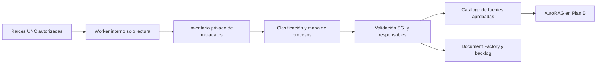

# Fase 0 — Business Discovery / SGI UNC Scanner

Propuesta de levantamiento documental inicial del Sistema de Gestión Integrado (SGI). El objetivo es descubrir cómo funciona el negocio a partir de la documentación existente, sin comenzar creando documentación duplicada ni indexar toda la red. Este documento no contiene rutas, nombres de archivos, clientes o datos reales.

## 1. Alcance y autorización
- Acordar con SGI, TI y seguridad una lista explícita de raíces UNC autorizadas (por ejemplo, ficticio: \\SERVIDOR-DEMO\SGI-DEMO\Procesos). No buscar servidores, enumerar recursos compartidos ni descubrir credenciales.
- Utilizar una identidad corporativa de solo lectura, con los permisos de recurso compartido y NTFS correspondientes. No elevar privilegios ni acceder a carpetas denegadas.
- Ejecutar un worker dentro de la red autorizada, no desde el navegador ni un proveedor externo. No modificar, mover, borrar, renombrar ni copiar masivamente archivos originales. Excluir enlaces/reparse points por defecto, limitar profundidad, volumen y concurrencia; acordar horarios de baja carga.
- Primera pasada: metadatos únicamente. La lectura del contenido, hashing y extracción se autorizan por separado. Guardar inventario, errores y rutas reales exclusivamente en almacenamiento corporativo privado, nunca en GitHub público.

## 2. Escaneo e inventario
1. Registrar las raíces aprobadas con source_id, alcance, propietario funcional, política de acceso y fecha.
2. Enumerar directorios y archivos dentro del alcance; capturar ruta UNC canónica, ruta relativa, extensión, tamaño, fecha de modificación y resultado. Identificar errores de acceso sin intentar sortearlos. No asumir que las carpetas inaccesibles están vacías.
3. Detectar candidatos a duplicados por metadatos; confirmar por hash SHA-256 únicamente en archivos autorizados para lectura. Identificar formatos PDF, DOCX, XLSX, PPTX, imágenes escaneadas y otros; registrar formatos no soportados, archivos cifrados o ilegibles.
4. En una segunda pasada autorizada, extraer títulos, códigos, revisiones, vigencia, aprobaciones y referencias con parsers locales. OCR local solo cuando haga falta y esté permitido. Distinguir campos confirmados, inferidos y desconocidos; fecha de modificación no equivale a vigencia.
5. Clasificar por macroproceso, proceso, subproceso, área, tipo documental, rol responsable, cliente (si autorizado), sistema relacionado y sensibilidad. Conciliar contra lista maestra y dueños de proceso.
6. Generar mapa de cobertura, referencias cruzadas, faltantes, contradicciones, documentos candidatos a obsoletos y actividades repetitivas. No declarar obsolescencia, incumplimiento o automatización viable sin validación humana.

## 3. Modelo de datos privado
| Entidad | Campos principales |
|---|---|
| Source | source_id, raíz UNC, propietario por rol, alcance, permisos, fecha |
| ScanRun | run_id, source_id, inicio/fin, límites, archivos vistos, errores, estado completo/parcial |
| Document | doc_id, source_id, ruta UNC, ruta relativa, formato, tamaño, mtime, hash opcional |
| DocumentVersion | doc_id, código, revisión, vigencia, aprobación, evidencia y clasificación |
| BusinessProcess | process_id, macroproceso, proceso, subproceso, entradas/salidas, responsable |
| DocumentProcessLink | doc_id, process_id, relación, evidencia, confianza, revisión |
| AccessPolicy | identidad/grupo, permisos efectivos, clasificación, restricciones de cliente |
| AutomationCandidate | proceso, tarea, frecuencia, esfuerzo base, evidencia, riesgo, decisión |

Usar identificadores opacos en informes que salgan del entorno autorizado. Rutas completas, nombres, ACL y hashes pueden ser sensibles. Registrar borrados o cambios de permisos en reconciliaciones incrementales; una fuente no disponible debe quedar como desconocida, no como eliminada.

## 4. Ejemplo sintético de matriz SGI
| Código | Documento | UNC ficticia | Proceso | Relación | Estado |
|---|---|---|---|---|---|
| PR-DEMO-01 | Procedimiento de análisis | \\SERVIDOR-DEMO\SGI-DEMO\Analisis\PR-DEMO-01.pdf | Análisis tecnológico | Define procedimiento | Por validar |
| FT-DEMO-02 | Formato levantamiento | \\SERVIDOR-DEMO\SGI-DEMO\Analisis\FT-DEMO-02.xlsx | Descubrimiento cliente | Entrada/salida | Por validar |
| IN-DEMO-03 | Instructivo de pruebas | \\SERVIDOR-DEMO\SGI-DEMO\Desarrollo\IN-DEMO-03.docx | Calidad de software | Criterio de aceptación | Por validar |

## 5. Flujo y centro de control

Pantallas: fuentes SGI, historial de escaneos, explorador de documentos con rutas visibles solo para autorizados, mapa proceso-documento, matriz de cobertura y revisiones, cola de clasificación, candidatos de automatización y fuentes aprobadas para RAG. Enlaces UNC se abren mediante mecanismo corporativo autorizado; no asumir que un navegador permite enlaces file://. Exportación redactada por defecto.

## 6. Herramientas candidatas
PowerShell Get-ChildItem -LiteralPath (worker Windows, sin seguir enlaces), .NET System.IO o Python pathlib/os.scandir (sobre UNC autorizada); Docling/Apache Tika, Apache POI, Tesseract para contenido autorizado; PostgreSQL/SQL corporativo para catálogo, pgvector para etapa B, Mermaid/bpmn.io/React Flow para mapa. No usar escáneres de red ni herramientas de descubrimiento de credenciales. Permisos efectivos deben verificarse con TI; no confiar únicamente en ACL capturadas.

## 7. Piloto de 2 semanas dentro del Plan A
| Actividad | Horas agregadas | Entregable |
|---|---:|---|
| Autorización, alcance y fuentes | 8 | Registro de raíces y exclusiones |
| Inventario limitado de metadatos | 12 | Catálogo y reporte de errores |
| Clasificación y revisión de muestra autorizada | 16 | Matriz documental y de procesos |
| Validación SGI y oportunidades | 8 | Mapa AS-IS y backlog priorizado |
| Informe y línea base | 4 | Cobertura, tiempos y decisión |
| Total | 48 | Valor ilustrativo 14,400 MXN a 300/h |

Incluido en las 240 h y 80,000 MXN del Plan A, no coste adicional automático. Reasignar tiempo de diagnóstico/ingeniería y acotar inicialmente a 1–2 raíces aprobadas, hasta 500 archivos de metadatos y una muestra de hasta 30 documentos para análisis si autorizado. Si el volumen, los permisos o la validación exceden el presupuesto, reducir alcance o solicitar revisión. No prometer un catálogo completo de la empresa.

KPIs: raíces aprobadas vs cubiertas, archivos vistos y accesibles, proporción de muestra clasificada y validada, documentos con código/revisión confirmados, enlaces proceso-documento aprobados, errores y exclusiones, horas invertidas, tiempo para localizar documentos antes/después. Gate A0: alcance firmado, evidencia trazable, inventario privado, revisión de responsables y ninguna modificación a los originales. Gate B: ingesta explícitamente aprobada y pruebas de permisos antes de activar RAG. No indexar la totalidad del SGI por defecto.

## 8. Entregables de negocio
Mapa macroproceso -> proceso -> procedimiento -> formato/evidencia -> sistema -> rol responsable; inventario UNC con estado y trazabilidad; mapa de brechas de documentación; backlog de automatizaciones y necesidades de formación; catálogo de fuentes candidatas para agentes y Document Factory. La clasificación documental sirve de hipótesis de funcionamiento, no sustituye entrevistas ni verificación de prácticas reales. No se ha ejecutado un escaneo real.
