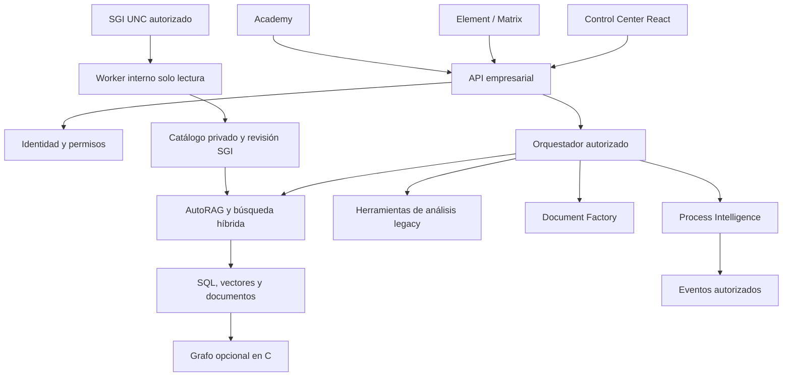

# Arquitectura objetivo y centro de control
La aplicación propuesta es un centro de control web para descubrimiento tecnológico, conocimiento, agentes, documentación y mejora de procesos. No es necesario construir todos los módulos al mismo tiempo.

| Módulo | Funcionalidades |
|---|---|
| Control Center | Panel de KPIs, búsqueda, filtros, auditoría, permisos |
| SGI Business Discovery | Raíces autorizadas, escaneos, inventario, matriz documento-proceso y revisión de fuentes |
| Client Intelligence | Inventario tecnológico, solicitudes, responsables funcionales y riesgos |
| People Intelligence | Roles, competencias declaradas y verificadas, procedimientos, revisiones |
| Process Intelligence | BPMN, eventos, tiempos, variantes y automatización |
| Technology Discovery | Sistemas, versiones, dependencias, integraciones y deuda técnica |
| Agent Studio | Configurar roles, Skills, modelos, herramientas, evaluaciones y revisiones |
| AutoRAG | Fuentes autorizadas, indexación incremental, citas, versiones y eliminación |
| Knowledge Graph | Relaciones entre procesos, roles, aplicaciones y documentos |
| Document Factory | Borradores con evidencia, plantillas, aprobación y exportación |
| Academy | Cursos impartidos, asistencia, evaluaciones y evidencias |
| Element Hub | Eventos, notificaciones y seguimiento de solicitudes |
| Modernization Factory | Matrices de paridad, backlog y pruebas legacy/PWA |
| ROI Intelligence | Línea base, esfuerzo, coste, calidad y resultados |

Stack candidato: React/TypeScript, React Flow y bpmn.io; backend Java/Spring Boot en versión aprobada, servicios Python/FastAPI si autorizados; PostgreSQL + pgvector, almacenamiento corporativo, LangGraph, Docling, Matrix, OIDC/SSO, OpenTelemetry. Grafo y minería solo tras validar necesidad. Monolito modular primero; no imponer microservicios ni nuevas bases de datos sin justificación.

Pantallas: inicio, clientes, inventario, mapas de procesos, fichas de competencias, agentes, fuentes/revisiones RAG, documentos, cursos, integraciones, modernización y ROI. Cada pantalla incluye permisos por rol, estado vacío, errores, trazabilidad y exportación controlada. Diseño responsive y accesible. Los datos de cualquier demo son sintéticos.
